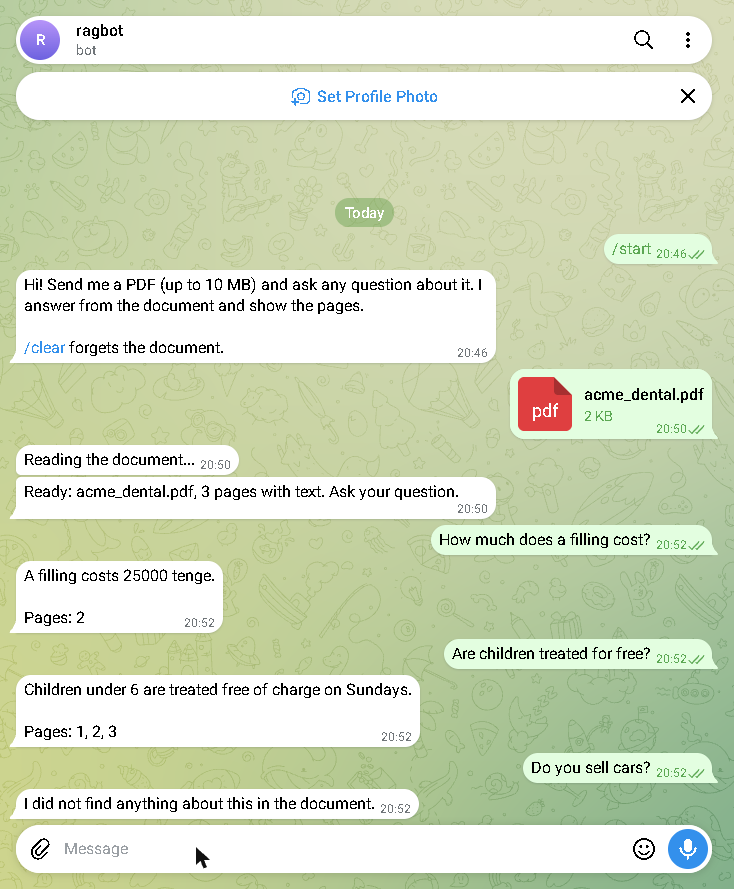

# rag-pdf-bot

Telegram bot that answers questions about a PDF you send it, and shows the pages the answer came from.

- Send a PDF (up to 10 MB), then ask questions in chat.
- Search: BM25 over page chunks, no vector database and no paid embeddings.
- Answers: Groq (free tier), with Gemini as a fallback. The model may use only the found excerpts.
- If the document does not contain the answer, the bot says so instead of guessing.

Stack: Python 3.12, aiogram 3, pypdf, aiohttp.



Try it with `samples/acme_dental.pdf`.

## Run

```
py -m venv .venv
.venv\Scripts\pip install aiogram pypdf python-dotenv
copy .env.example .env      # fill BOT_TOKEN (from @BotFather) and GROQ_API_KEY
.venv\Scripts\python -m bot.main
```

## Test

```
.venv\Scripts\pip install pytest
.venv\Scripts\python -m pytest -q
```

## Limits

- Scanned PDFs (images without text) are not supported: the bot tells the user.
- Search matches words, so ask in the language of the document.
- The document is kept in memory per user and is forgotten after a restart or `/clear`.
